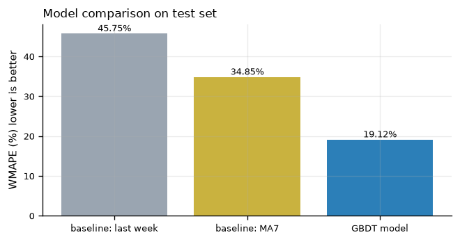
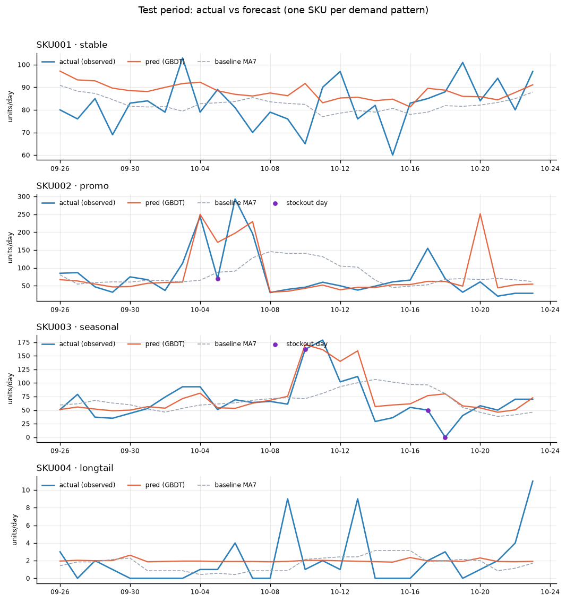
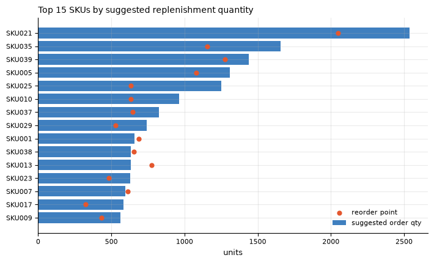
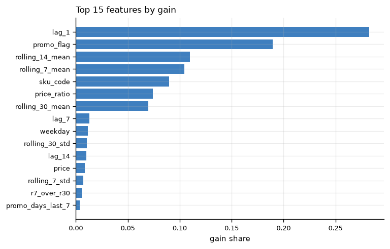

# AI 辅助电商销量预测与库存优化

一个端到端可复现的 **销量预测 → 库存决策** 小型项目：从模拟的 SKU×日 销量数据出发，用 LightGBM 做日销量预测，再用预测误差反推安全库存、再订货点和补货量，最终给出一张可以直接给补货同学看的 `replenishment_table.csv`。

> 当前数据是**模拟数据**（还没有真实业务数据）。项目的重点不是"预测得多准"，而是把**一条正确的、没有信息泄漏的、指标可解释的链路**跑通，并明确标出以后接真实数据要替换哪些地方。

---

## 1. 目录结构

```
ai-ecommerce-demand-forecast-inventory/
├── data/
│   ├── raw/                    sales_daily.csv：原始模拟数据（生成物，不入库）
│   └── processed/              sales_clean.csv / features.csv / split_info.json
├── notebooks/
│   └── 01_eda.ipynb            探索性分析：模式识别、促销弹性、断货影响、滞后相关性
├── src/
│   ├── config.py               全部可调参数：路径 / 种子 / 服务水平 / 切分比例 / 模型参数
│   ├── data_generator.py       生成模拟电商日销量数据（含库存仿真与断货截断）
│   ├── data_prep.py            清洗：类型、去重、补齐连续日历、异常值、质量报告
│   ├── features.py             滞后 / 滑动窗口 / 促销 / 节假日特征 + 严格时间切分
│   ├── train.py                基线模型 + LightGBM 主模型训练与推理
│   ├── evaluate.py             MAE / RMSE / MAPE / WMAPE 评估与可视化
│   └── inventory.py            安全库存 / 再订货点 / 建议补货量
├── results/                    所有输出：预测明细、指标 json、补货表、图表
├── requirements.txt
├── README.md
└── .gitignore
```

### 文件任务简述

| 文件 | 职责 | 关键产出 |
|---|---|---|
| `src/config.py` | 单一配置源。改服务水平、切分比例、模型参数、SKU 数量都只改这里 | — |
| `src/data_generator.py` | 造数据。四种需求模式（稳定/促销/季节/长尾）+ 马尔可夫促销日历 + 节假日抬升 + **库存仿真制造断货** | `data/raw/sales_daily.csv` |
| `src/data_prep.py` | 清洗与校验。补连续日历（时序缺行会让 lag 错位）、去重、异常值、打印质量报告 | `data/processed/sales_clean.csv`、`data_quality_report.json` |
| `src/features.py` | 20 个特征 + 按日期切分 train/valid/test，前 14 天标为 warmup | `data/processed/features.csv`、`split_info.json` |
| `src/train.py` | 训练两个基线 + LightGBM，验证集 early stopping，测试集只评估一次；模型按 LightGBM→XGBoost→sklearn 自动降级 | `forecast_test.csv`、`forecast_valid.csv`、`feature_importance.csv`、`model_lgbm.joblib`、`train_meta.json` |
| `src/evaluate.py` | 四指标评估、分模式/分 SKU 拆解、四张图 | `model_metrics.json`、`metrics_by_sku.csv`、`figures/*.png` |
| `src/inventory.py` | SS / ROP / 建议补货量，参数快照落盘 | `replenishment_table.csv`、`inventory_params.json`、`figures/replenishment_top.png` |
| `notebooks/01_eda.ipynb` | 用图讲清楚数据长什么样、为什么这么建模 | 图表（在 notebook 里内联） |

---

## 2. 本地运行

```bash
# 1) 环境（Python >= 3.10）
python -m venv .venv
# Windows
.venv\Scripts\activate
# macOS / Linux
source .venv/bin/activate

pip install -r requirements.txt
# 国内网络慢的话加镜像：
# pip install -r requirements.txt -i https://pypi.tuna.tsinghua.edu.cn/simple

# 2) 按顺序跑（每一步都可以单独跑，也可以重复跑，结果幂等）
python -m src.data_generator   # 生成 data/raw/sales_daily.csv
python -m src.data_prep        # 清洗 → data/processed/sales_clean.csv
python -m src.features         # 特征 + 时间切分 → data/processed/features.csv
python -m src.train            # 训练 + 测试集预测 → results/forecast_test.csv
python -m src.evaluate         # 四指标 + 图表
python -m src.inventory        # 补货建议 → results/replenishment_table.csv
```

`python -m src.xxx` 必须在**项目根目录**执行（`src` 是包）。

懒人版：直接 `python -m src.train`，它会检测缺数据并自动补跑 `data_prep` + `features`；`evaluate` 和 `inventory` 同理，缺输入会自动回溯上一步。

Notebook 方式（推荐，环境和工作目录都自动对）：

```bash
# Windows：直接双击项目根目录下的 start_jupyter.bat
# 或手动指定，务必让 cwd 是项目根：
cd ai-ecommerce-demand-forecast-inventory
.venv\Scripts\jupyter-notebook.exe      # 打开 notebooks/01_eda.ipynb，从上到下执行
```

第一个代码单元会先定位项目根，然后打印三行诊断信息：

```
项目根目录：F:\...\ai-ecommerce-demand-forecast-inventory
定位方式  ：① 硬编码绝对路径
内核 Python：...\.venv\Scripts\python.exe
依赖版本  ：pandas 3.1.0 | numpy 2.5.4 | matplotlib 3.11.2
```

### 已经在用别的 Jupyter？把 .venv 注册成可选内核

很多人本机已经有一个 Jupyter（比如 Anaconda 自带的、跑在 8888）。**不要直接用它默认的 `python3` 内核跑模型** —— 那个内核里通常没有 lightgbm/xgboost，`train.py` 会降级成 sklearn 的 GradientBoosting，而且会把 `results/` 里已有的好结果覆盖成更差的版本。

只需注册一次，之后在 KERNEL → Change kernel 里就能选：

```bash
.venv\Scripts\python.exe -m ipykernel install --user ^
    --name "ai-ecom-venv" ^
    --display-name "ai-ecom .venv (Python 3.13 + LightGBM)"
```

- 装到用户级目录（`%APPDATA%\jupyter\kernels\`），所以**所有** Jupyter 实例都能看到，且**不需要重启 Jupyter 服务**，刷新页面即可；
- 内核列表里会出现 `ai-ecom .venv (Python 3.13 + LightGBM)`，选中它 → Restart & Run All；
- 第一格的 `内核 Python` 那行应该变成 `...\.venv\Scripts\python.exe`，`依赖版本` 变成 `pandas 3.1.0`，并且**不再**出现"未安装 lightgbm"的提示；
- 卸载：`jupyter kernelspec remove ai-ecom-venv`。

在 notebook 里调脚本，务必用 `!{sys.executable} -m src.xxx`，不要写 `!python -m src.xxx`（后者会用 PATH 里的解释器，往往是 Anaconda 的）：

```python
%cd {ROOT}
!{sys.executable} -m src.train
!{sys.executable} -m src.evaluate
!{sys.executable} -m src.inventory
```

**看到这四行就说明环境通了**。顺手还能用它判断"内核是不是选错了"——`内核 Python` 必须是你装了依赖的那个解释器。

### 常见报错

| 报错 | 原因 | 解决 |
|---|---|---|
| `RuntimeError: 找不到项目根目录` | **Jupyter 内核的工作目录不在项目根，且不在同一条盘上**。`src` 是项目内的包，只有 cwd（或 `sys.path`）指向项目根时才能 import。典型触发：Jupyter 从 `C:\Users\<你>` 启动（根目录就是主目录），而项目在 `F:\`——**从主目录向上查找永远到不了 F 盘** | ①双击 `start_jupyter.bat`；②在项目根启动 Jupyter；③把启动单元里 `PROJECT_ROOT_OVERRIDE` 改成项目绝对路径 |
| `TypeError: apply() got an unexpected keyword argument 'include_groups'` | `include_groups` 是 pandas **2.2** 才加的参数，pandas 2.0 / 1.x 没有（Anaconda 默认就是 2.0.3） | 已修复：改用显式循环，兼容 pandas 1.x~3.x。若你改了代码又复现，同理避免用这个参数 |
| `ModuleNotFoundError: No module named 'pandas'` | notebook 选的内核不是你装依赖的那个 Python | 右上角切 kernel 到 `.venv`（Windows: `.venv\Scripts\python.exe`），或用 `start_jupyter.bat` |
| `python -m src.train` 报 `No module named src` | 终端不在项目根 | 先 `cd ai-ecommerce-demand-forecast-inventory` |
| `FileNotFoundError: data/raw/sales_daily.csv` | 还没生成数据 | 先 `python -m src.data_generator`（`train` 会自动补跑，直接跑 `data_prep` 不会） |
| 提示"内核未安装 lightgbm / xgboost" | 用了 Anaconda 的 base 环境，里面没有这两个库 | EDA 不受影响；跑模型请用 `.venv`（`start_jupyter.bat` 启动的默认就是它）。`src/train.py` 会自动降级到 sklearn 的 GradientBoosting |

启动单元做四路兜底，按成本从低到高：①`PROJECT_ROOT_OVERRIDE` 手动指定（**默认留空**，只在自动定位失败时才需要填）→②cwd 逐级向上 + 检查一级子目录 →③notebook 文件自身位置（`__vsc_ipynb_file__` / `JPY_SESSION_NAME`）→④在常见根目录按项目名限深度扫描。找到后还会 `os.chdir(项目根)`，让 notebook 里的相对路径和命令行完全一致。四条全失败才报错，且报错信息里直接带当前 cwd 和三种解法，不会丢一个裸 traceback。

> 默认留空是有意为之：写死绝对路径会让 notebook 换台机器就跑不了，也不适合公开在仓库里。用 `start_jupyter.bat` 启动时走的是 ②，通常 1 秒内命中。

---

## 3. 数据说明

粒度 **SKU × 日期（日）**，最近 180 天，40 个 SKU（4 种模式各 10 个），共 7,200 行。

| 字段 | 含义 |
|---|---|
| `sku_id` | 商品编码 |
| `date` | 日期（日粒度，连续无缺口） |
| `category` | 品类（5 类，影响价格量级） |
| `price` | 当日售价（促销日打折，可作特征） |
| `promo_flag` | 是否促销日（成簇出现，不是随机散点） |
| `holiday_flag` | 是否法定节假日（按真实节假日区间打标） |
| `units_sold` | **观测销量**（断货时被库存截断，可能为 0） |
| `on_hand_inventory` | 当日收盘在库 |
| `lead_time_days` | 供应商提前期（3~14 天） |
| `stockout_flag` | **需求未被完全满足 = 1**（含部分断货；完全无货的日子 `units_sold=0`） |
| `demand_latent` | ⚠️ **模拟数据独有**：真实需求。仅用于检验截断处理是否正确，**绝不可当特征** |
| `sku_pattern` | ⚠️ **模拟数据独有**：需求模式标签。EDA 用，不进模型 |

### 四种需求模式

| 模式 | 特征 | 生成方式 |
|---|---|---|
| `stable` 稳定型 | 水位平稳、周末微升 | 泊松分布 + 弱周内效应 |
| `promo` 促销型 | 促销日 3~5 倍爆发，促销后 2 天回落 | 负二项分布（过度离散）+ 提前购买回落 |
| `seasonal` 季节型 | 90 天中周期 + 强周末效应 | 正弦叠加 + 泊松 |
| `longtail` 长尾型 | 日均 < 3 件、大量 0、偶发爆量 | 小均值负二项 + 4% 概率爆量日 |

### 为什么要有 `stockout_flag`

真实电商数据里，`units_sold = 0` 有两种完全不同的原因：**没人买** 和 **没货卖**。
把两者混在一起，模型会学到"那天就是 0"，从而系统性低估需求。本项目的处理是：

1. 用库存仿真让断货自然发生，并把 `stockout_flag` 记下来（不假装需求是 0，用 `demand_latent` 保留真值）；
2. 训练/验证时**剔除** `stockout_flag=1` 的行（这些行的 y 被低估，标签不可信）；
3. 评估时主指标只算未断货行，同时单独报告断货占比。

---

## 4. 方法说明

### 4.1 特征（`src/features.py`）

| 组 | 特征 |
|---|---|
| 滞后 | `lag_1` / `lag_7` / `lag_14` |
| 滑动窗口 | `rolling_7_mean` / `rolling_7_std` / `rolling_14_mean` / `rolling_30_mean` / `rolling_30_std` / `r7_over_r30` |
| 日历 | `weekday` / `month` / `day_of_month` / `is_weekend` |
| 业务 | `promo_flag` / `promo_days_last_7` / `holiday_flag` / `price` / `price_ratio` / `lead_time_days` |
| 类别 | `sku_code` / `category_code` |

**防泄漏铁律**：所有滞后和滑动窗口都先 `shift(1)` 再计算，等于"只用截至昨天的信息预测今天"；滚动窗口在 `sku_id` 内分组，不跨 SKU 串数据。

### 4.2 时间切分

| 集合 | 比例 | 用途 |
|---|---|---|
| train | 前 70% 日期 | 训练 |
| valid | 中间 15% 日期 | early stopping、误差 σ 估计 |
| test | 最后 15% 日期 | **只评估一次**，不参与任何调参 |

同一日期下的所有 SKU 归入同一集合（避免"用未来 SKU 的历史预测过去"）。前 14 天因 `lag_14`/`rolling_30` 缺失被标为 `warmup`，不参与训练与评估。

### 4.3 模型

- 基线 1 `baseline_last_week`：上周同一天销量（`lag_7`）
- 基线 2 `baseline_ma_7`：近 7 天移动平均（`rolling_7_mean`）
- 主模型：LightGBM（`objective=regression`，`metric=mae`，早停 80 轮，`seed=42`，`deterministic=True`）

**基线存在的意义**：零售日销量的周内重复性很强，MA7 往往已经很难打败。如果 LightGBM 赢不了基线，说明特征没做对。

### 4.4 评估指标

| 指标 | 定义 | 说明 |
|---|---|---|
| MAE | mean(\|y-ŷ\|) | 单位=件，业务最好理解 |
| RMSE | sqrt(mean((y-ŷ)²)) | 对大误差更敏感（促销尖峰漏预测会被放大） |
| MAPE | mean(\|y-ŷ\|/y)×100% | 剔除 y=0 的样本，并报告剔除占比 |
| **WMAPE** | Σ\|y-ŷ\| / Σy ×100% | **主指标**，等价整体偏差率，不受小基数放大 |

### 4.5 库存公式（`src/inventory.py`）

```
mu_d     = 测试期最后 28 天的平均预测           # 日需求速率
sigma_d  = 该 SKU 验证集残差标准差（向池化值收缩）
mu_L     = mu_d × L                           # 提前期内需求
sigma_L  = sigma_d × sqrt(L)                  # 提前期误差（日误差独立假设）
SS       = z × sigma_L                        # 安全库存
ROP      = mu_L + SS                          # 再订货点
S        = mu_d × (L + R) + SS                # 目标水位（R = 复核周期 7 天）
Q        = max(0, S - 当前在库) → 向上取到起订倍数   # 建议补货量
```

服务水平 95% → `z = 1.645`，由 `NormalDist().inv_cdf(0.95)` 算出（不是写死常数），改 `config.SERVICE_LEVEL` 即可，例如 90% → 1.2816，99% → 2.3263。

`sigma_d` 用"单 SKU 标准差 与 全体池化标准差 的方差加权收缩"（默认权重 0.4）：验证期只有 20 多天，单 SKU 标准差极不稳定，收缩能明显降低补货量的抖动。

---

## 5. 输出文件

| 文件 | 内容 |
|---|---|
| `results/forecast_test.csv` | 测试集逐行预测：实际、各模型预测、断货标记、真实需求（仅模拟数据） |
| `results/forecast_valid.csv` | 验证集预测与残差（供库存模块估计 σ） |
| `results/model_metrics.json` | 整体 / 分模式 / 全量对照指标 |
| `results/metrics_by_sku.csv` | 每个 SKU 的 MAE 与 WMAPE（看模型在哪类商品失效） |
| `results/feature_importance.csv` | 特征 gain 与占比 |
| `results/replenishment_table.csv` | **核心业务产出**：`sku, forecast_demand, safety_stock, reorder_point, suggested_order_qty` + 在库/覆盖天数/紧急标记 |
| `results/inventory_params.json` | 补货参数快照（服务水平、z 值、公式口径），保证结果可追溯 |
| `results/figures/*.png` | 预测曲线、日销总量、特征重要性、模型对比、补货量 Top15 |

---

## 6. 实测结果（当前模拟数据 + 固定种子，可复现）

测试期 2026-09-26 ~ 2026-10-23，1,120 行，剔除断货行后 1,062 行参与评估：

| 模型 | MAE | RMSE | MAPE | **WMAPE（主指标）** |
|---|---|---|---|---|
| baseline 上周同日（lag_7） | 24.68 | 48.08 | 73.4% | 45.7% |
| baseline 近 7 天均值 | 18.80 | 35.47 | 53.6% | 34.8% |
| **LightGBM** | **10.32** | **17.73** | **35.7%** | **19.1%** |

分模式 WMAPE（LightGBM vs 基线 MA7）：

| 模式 | LightGBM | 基线 MA7 | 说明 |
|---|---|---|---|
| stable | 9.7% | 16.0% | 平稳序列，树模型仍能靠价格/促销把误差压下来 |
| seasonal | 17.9% | 34.3% | 主要收益来自对周末效应的刻画 |
| promo | 34.5% | 66.8% | 收益最大：`promo_flag` + `promo_days_last_7` 抓住了尖峰 |
| longtail | 81.9% | 82.3% | **几乎没提升**，与 EDA 里"长尾自相关≈0"一致 |

怎么读这组数（避免过度解读）：

- 相对 MA7，WMAPE 从 34.8% 降到 19.1%，收益集中在促销型和季节型；
- 长尾型 82.3% → 81.9%，本质是**信息不足而非调参不足**，该换方法而不是继续调 GBDT；
- **绝对数值不代表真实业务的预期精度**：这是模拟数据，信噪比是人为设定的。

> 每次运行的数字会因为 pandas / LightGBM 版本略有浮动，但趋势稳定；`results/*.json` 里存的是当次运行的准确值。

### 结果预览

**三模型指标对比**（越低越好）



**测试期：预测 vs 实际**（按四种模式分面，橙色为促销日）



**补货建议 Top SKU**



**特征重要性**



> 以上图由 `python -m src.evaluate` 与 `python -m src.inventory` 生成，完整清单见 `results/figures/`。

---

## 7. 若换成真实电商数据改动说明

按改动量从小到大：

| # | 位置 | 要做什么 |
|---|---|---|
| 1 | `src/data_prep.py::load_raw` | 把读 CSV 换成读你们的表（数仓 SQL / ODS 导出 / `pd.read_sql`），并做**字段映射**：`units_sold → 出库量或支付件数`、`on_hand_inventory → 可用库存` |
| 2 | `src/data_generator.py` | 真实数据到位后整个文件可以**删除**，或只保留作为单测夹具 |
| 3 | `src/config.py::HOLIDAY_RANGES` | 换成 `chinese_calendar` 库自动生成，并区分"法定节假日 / 大促（618、双11、双12）/ 品类活动日" |
| 4 | `src/config.py::ANCHOR_DATE` | 改成"数据里的最大日期"，让窗口随数据滚动 |
| 5 | `src/features.py` | 补真实电商特征：**大促日历**（预售/开门红/尾款）、**流量特征**（UV、加购、收藏）、**价格竞争**（竞品价、到手价）、**评价**（评分、评论数）、**商品生命周期**（上新天数）、**地区维度**（分仓销量） |
| 6 | `src/data_prep.py` | 补齐真实数据才有的坑：**退货/取消单冲减**、**赠品与组合装**、**SKU 换绑**、**多仓库存汇总**、**时区与业务日切点** |
| 7 | `src/train.py` | 真实数据量下改为分品类/分模式建模，或加 `sample_weight`（按销售额加权）；调参换成 Optuna |
| 8 | `src/inventory.py` | 接入真实供应链参数：MOQ、装箱数、在途库存、供应商可用产能、仓储容量约束；长尾 SKU 从正态假设换成 **bootstrap 经验分位数** |
| 9 | 全链路 | 加数据校验（pandera / great_expectations）、加滚动回测（walk-forward）、加模型监控（预测偏差告警） |

**必须删掉/不能带进真实数据的列**：`demand_latent`、`sku_pattern`、以及生成器的库存仿真逻辑。它们在真实世界不可观测，留着就是泄漏。

---

## 8. 模型已知局限

1. **需求截断**：只用"断货行剔除"这个朴素办法，没做截断需求还原（censored demand recovery，如 EM / Tobit / 两阶段模型）。断货率高的 SKU 仍会低估。
2. **正态假设**：安全库存用 `z × sigma × sqrt(L)`，长尾间歇需求（大量 0）不适合正态假设，应该用 bootstrap 或负二项分位数。
3. **提前期固定**：`lead_time_days` 当作常数，真实场景有波动，`sigma_L` 应把提前期方差也算进去：`sigma_L = sqrt(L·sigma_d² + mu_d²·sigma_LT²)`。
4. **单步预测**：只做"明天"的预测，多步预测（未来 7/14 天）目前靠"用未来几天的预测均值"近似，没有递归或直接多步建模。
5. **没有成本函数**：补货量只按服务水平约束，没有把缺货成本（毛利损失）和持有成本（资金占用）放进目标函数里做权衡。

## 9. 复现性

- 所有随机过程统一从 `config.RANDOM_SEED = 42` 派生，每个 SKU 用独立子种子（加 SKU 不会改变已有 SKU 的数据）；
- 数据截止日 `ANCHOR_DATE` 固定，保证任何时候跑出来的数据完全一致；
- LightGBM 开启 `deterministic=True`、`force_row_wise=True`，同机结果稳定；
- 每次运行都会写 `split_info.json`、`train_meta.json`、`inventory_params.json` 三个参数快照，任何一张结果表都能追溯到口径。

## 10. 许可

[MIT License](LICENSE) © 2026 Chen YuFei

代码可自由使用、修改、商用，保留版权声明即可。数据是 `src/data_generator.py` 生成的模拟数据，不含任何真实业务信息。
